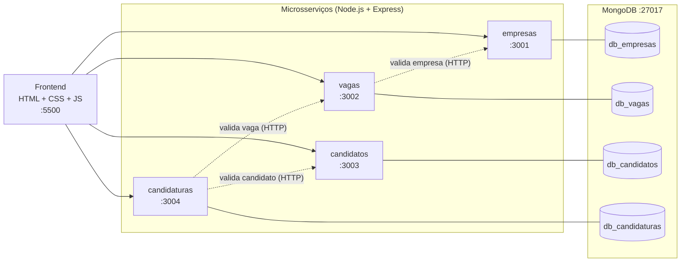

# 💼 InfanteJobs — Plataforma de Vagas e Candidaturas

Projeto Integrador: plataforma web para **empresas publicarem vagas** e **candidatos se inscreverem**, construída com uma arquitetura de **microsserviços desacoplados**. Os serviços se comunicam por **HTTP/REST (JSON)** e cada um possui seu próprio banco **MongoDB** (*database-per-service*).


---

## 📑 Sumário

1. [Visão geral](#-visão-geral)
2. [Arquitetura](#-arquitetura)
3. [Stack tecnológica](#-stack-tecnológica)
4. [Estrutura do repositório](#-estrutura-do-repositório)
5. [Como executar](#-como-executar)
6. [Referência da API](#-referência-da-api)
7. [Testando os serviços](#-testando-os-serviços)
8. [Decisões de projeto](#-decisões-de-projeto)
9. [Status e próximos passos](#-status-e-próximos-passos)

---

## 🎯 Visão geral

| Perfil | O que pode fazer |
| :--- | :--- |
| **Empresa** | Cadastrar-se, publicar vagas, acompanhar e encerrar vagas. |
| **Candidato** | Criar perfil profissional, buscar vagas (filtros por cidade, modalidade e status) e se candidatar. |

---

## 🏗️ Arquitetura



| Microsserviço | Porta | Banco | Responsabilidade |
| :--- | :---: | :--- | :--- |
| **`Empresas`** | `3001` | `db_empresas` | CRUD de empresas (nome, CNPJ, contato). |
| **`vagas`** | `3002` | `db_vagas` | CRUD de vagas e ciclo de vida (`ABERTA` → `FECHADA`). Valida a empresa consultando `:3001`. |
| **`candidatos`** | `3003` | `db_candidatos` | CRUD de perfis de candidatos (dados pessoais e habilidades). |
| **`candidaturas`** | `3004` | `db_candidaturas` | Registro e acompanhamento de inscrições. Valida vaga (`:3002`) e candidato (`:3003`). |

---

## 🛠️ Stack tecnológica

* **Backend:** Node.js, Express 5, Mongoose, Axios (comunicação entre serviços), CORS, dotenv.
* **Frontend:** HTML5 semântico, CSS3 e JavaScript nativo (`fetch` + DOM), sem framework.
* **Testes:** Jest + Supertest (integração no backend) e Cypress (E2E no frontend).
* **Banco de dados:** MongoDB (um banco lógico por serviço).

---

## 📂 Estrutura do repositório

```text
infantejobs/
├── README.md
├── seed.js                      # Popula os 4 bancos com dados de exemplo
├── package.json                 # Scripts do frontend e do Cypress
├── cypress.config.js
├── cypress/e2e/                 # Testes E2E (cadastro de empresa, candidatura)
├── frontend/                    # Páginas HTML, css/style.css e js/ (api.js centraliza as chamadas)
│   └── README.md                # Guia específico do frontend
└── services/
    ├── Empresas/                # :3001
    ├── vagas/                   # :3002
    ├── candidatos/              # :3003
    └── candidaturas/            # :3004
        ├── server.js            # Conecta ao MongoDB e executa app.listen()
        ├── src/
        │   ├── app.js           # Express, middlewares e rotas (exporta app p/ testes)
        │   ├── config/db.js     # Conexão Mongoose
        │   ├── controllers/
        │   ├── models/
        │   ├── routes/
        │   └── services/        # Clientes HTTP para outros microsserviços
        └── tests/               # Jest + Supertest
```

> Separar `app.js` de `server.js` permite que o Supertest teste as rotas em memória, sem abrir portas de rede.

---

## 🚀 Como executar

### 1. Pré-requisitos
* **Node.js** 18+ e **npm**
* **MongoDB** na porta `27017`:
  ```bash
  sudo systemctl start mongod
  # ou, com Docker:
  docker run -d --name mongo -p 27017:27017 mongo:7
  ```

### 2. Variáveis de ambiente
Crie um `.env` em cada pasta `services/<servico>/` (o `.env` não é versionado):

| Serviço | `PORT` | `MONGODB_URI` | URLs internas |
| :--- | :---: | :--- | :--- |
| `Empresas` | `3001` | `mongodb://localhost:27017/db_empresas` | — |
| `vagas` | `3002` | `mongodb://localhost:27017/db_vagas` | `EMPRESAS_SERVICE_URL=http://localhost:3001/empresas` |
| `candidatos` | `3003` | `mongodb://localhost:27017/db_candidatos` | — |
| `candidaturas` | `3004` | `mongodb://localhost:27017/db_candidaturas` | `VAGAS_SERVICE_URL=http://localhost:3002/vagas`<br>`CANDIDATOS_SERVICE_URL=http://localhost:3003/candidatos` |

### 3. Subir os microsserviços
Um terminal por serviço, nesta ordem (há dependência entre eles):

```bash
cd services/Empresas     && npm install && npm run dev   # :3001
cd services/vagas        && npm install && npm run dev   # :3002
cd services/candidatos   && npm install && npm run dev   # :3003
cd services/candidaturas && npm install && npm run dev   # :3004
```

### 4. (Opcional) Popular o banco com dados de exemplo
Na raiz do projeto:
```bash
npm install mongoose   # apenas na primeira vez
node seed.js
```
> ⚠️ O `seed.js` **apaga** os registros existentes das coleções antes de inserir. Use apenas em ambiente local.

### 5. Subir o frontend
Na raiz do projeto:
```bash
npm install
npm run serve:frontend   # http://localhost:5500
```
Veja também o [guia do frontend](frontend/README.md).

---

## 📡 Referência da API

| Serviço | Método | Rota | Descrição |
| :--- | :---: | :--- | :--- |
| Empresas | `GET` | `/empresas` | Lista empresas |
| | `GET` | `/empresas/:id` | Busca por ID |
| | `POST` | `/empresas` | Cria empresa |
| | `PUT` | `/empresas/:id` | Atualiza empresa |
| | `DELETE` | `/empresas/:id` | Remove empresa |
| Vagas | `GET` | `/vagas` | Lista vagas (`?status=&modalidade=&cidade=&empresaId=`) |
| | `GET` | `/vagas/:id` | Busca por ID |
| | `POST` | `/vagas` | Cria vaga (valida `empresaId` no serviço de Empresas) |
| | `PUT` | `/vagas/:id` | Atualiza vaga |
| | `PATCH` | `/vagas/:id/fechar` | Fecha a vaga (`ABERTA` → `FECHADA`) |
| | `DELETE` | `/vagas/:id` | Remove vaga |
| Candidatos | `GET` | `/candidatos` | Lista candidatos |
| | `GET` | `/candidatos/:id` | Busca por ID |
| | `POST` | `/candidatos` | Cria candidato |
| | `PATCH` | `/candidatos/:id` | Atualiza candidato |
| | `DELETE` | `/candidatos/:id` | Remove candidato |
| Candidaturas | `GET` | `/candidaturas` | Lista (`?candidatoID=&vagaID=&status=&data=`) |
| | `GET` | `/candidaturas/:id` | Busca por ID |
| | `POST` | `/candidaturas` | Candidata-se a uma vaga |
| | `PATCH` | `/candidaturas/:id/status` | Atualiza o status |
| | `DELETE` | `/candidaturas/:id` | Cancela candidatura |

**Status de candidatura:** `ENVIADA`, `EM_ANALISE`, `APROVADA`, `REJEITADA`.

---

## 🧪 Testando os serviços

### Testes automatizados

```bash
# Backend (por serviço): Jest + Supertest
cd services/vagas && npm test
npm test -- --watch            # modo interativo
npm test -- --detectOpenHandles # diagnostica conexões pendentes

# Frontend E2E (na raiz): Cypress
npm run cypress:open           # modo interativo
npm run test:e2e               # headless (sobe o frontend automaticamente)
```

Estrutura básica de um teste de integração:

```javascript
require('dotenv').config({ quiet: true });
const mongoose = require('mongoose');
const os = require('os'); // evita timeout do driver na sandbox do Jest (Mongoose 9)
const request = require('supertest');
const app = require('../src/app');

describe('Microsserviço', () => {
  beforeAll(() => mongoose.connect(process.env.MONGODB_URI, { runtimeAdapters: { os } }));
  afterAll(() => mongoose.connection.close());

  it('lista recursos', async () => {
    const res = await request(app).get('/vagas');
    expect(res.statusCode).toBe(200);
  });
});
```

### Teste manual do fluxo completo (curl)

Com os 4 serviços no ar, execute em ordem e guarde os `_id` retornados.

**1. Criar empresa**
```bash
curl -X POST http://localhost:3001/empresas -H "Content-Type: application/json" \
  -d '{"nome":"Acme Ltda","cnpj":"12345678000199","cidade":"São Paulo","endereco":"Rua A, 100","telefone":"11999999999","email":"contato@acme.com"}'
```

**2. Criar vaga** (usa o `_id` da empresa)
```bash
curl -X POST http://localhost:3002/vagas -H "Content-Type: application/json" \
  -d '{"titulo":"Dev Node.js","descricao":"API REST com Express","salario":8000,"modalidade":"Remoto","cidade":"São Paulo","requisitos":["Node.js","MongoDB"],"empresaId":"<ID_DA_EMPRESA>"}'
```

**3. Criar candidato**
```bash
curl -X POST http://localhost:3003/candidatos -H "Content-Type: application/json" \
  -d '{"nome":"Maria Silva","cpf":"12345678900","cidade":"São Paulo","telefone":"11988888888","email":"maria@email.com","habilidades":["JavaScript","Node.js"]}'
```

**4. Candidatar-se**
```bash
curl -X POST http://localhost:3004/candidaturas -H "Content-Type: application/json" \
  -d '{"candidatoID":"<ID_DO_CANDIDATO>","vagaID":"<ID_DA_VAGA>"}'
```

**5. Consultar e alterar**
```bash
curl "http://localhost:3002/vagas?status=ABERTA&modalidade=Remoto"
curl http://localhost:3002/vagas/<ID_DA_VAGA>
curl -X PATCH http://localhost:3002/vagas/<ID_DA_VAGA>/fechar
curl -X PATCH http://localhost:3004/candidaturas/<ID_DA_CANDIDATURA>/status \
  -H "Content-Type: application/json" -d '{"status":"EM_ANALISE"}'
```

### Cenários de erro (validam a integração entre serviços)

| Teste | Ação | Resposta esperada |
| :--- | :--- | :---: |
| Vaga sem `empresaId` | `POST /vagas` sem o campo | `400` |
| Empresa inexistente | `POST /vagas` com ObjectId válido que não existe | `400` / `404` |
| Serviço de Empresas fora do ar | Parar `:3001` e fazer `POST /vagas` | `503` |
| ID malformado | `GET /vagas/abc` | `400` |
| Vaga inexistente | `GET /vagas/<ObjectId inexistente>` | `404` |
| Fechar vaga já fechada | `PATCH /vagas/:id/fechar` duas vezes | `409` |
| Candidatura duplicada | Repetir `POST /candidaturas` com mesmo par | erro (índice único) |
| CNPJ / CPF duplicado | Repetir `POST` de empresa / candidato | erro (chave única) |

> Dica: para ver só o status HTTP, adicione `-s -o /dev/null -w "%{http_code}\n"` ao `curl`.

### Inspecionando o MongoDB
```bash
mongosh
> show dbs
> use db_vagas
> db.vagas.find().pretty()
```

---

## 🧠 Decisões de projeto

* **Database-per-service:** cada microsserviço é dono dos seus dados; não há *foreign keys* nem `populate()` entre bancos. Os relacionamentos são feitos por **IDs de referência** (`empresaId`, `vagaID`, `candidatoID`).
* **Integridade referencial via HTTP:** antes de gravar, o serviço consumidor valida a existência da entidade externa por um cliente HTTP (`empresaClient.js`, `vagasClient.js`, `candidatosClient.js`).
* **Resiliência:** chamadas entre serviços usam *timeout* (3s) e traduzem falhas de rede em `503 Service Unavailable`, diferenciando "recurso não existe" de "serviço indisponível".
* **Frontend desacoplado:** todas as chamadas HTTP passam por `frontend/js/api.js`, e as URLs base são configuráveis.
* **Testabilidade:** separação `app.js` / `server.js` para testes de integração sem portas de rede.

---

## 🗺️ Status e próximos passos

- [x] CRUD de Empresas, Vagas e Candidatos
- [x] Ciclo de vida da vaga (`ABERTA` / `FECHADA`)
- [x] Validação de empresa na criação de vaga (comunicação entre serviços)
- [x] Frontend com integração às APIs e testes E2E iniciais
- [ ] Validar existência de vaga e candidato em `POST /candidaturas`
- [ ] Enriquecer `GET /candidaturas/:id` com dados da vaga e do candidato
- [ ] Armazenar `empresaNome` na vaga (*data snapshot*) para evitar chamadas em listagens
- [ ] Autenticação (JWT) e autorização por perfil
- [ ] Containerização com Docker Compose
- [ ] Cobertura de testes para `candidatos`

---

## 👥 Equipe

Projeto desenvolvido como Projeto Integrador.

<table align="center">
  <tr>
    <td align="center">
      <a href="https://github.com/Teylortrt">
        <br />
        <sub><b>Teylortrt</b></sub>
      </a>
    </td>
    <td align="center">
      <a href="https://github.com/fitofossil">
        <br />
        <sub><b>fitofossil</b></sub>
      </a>
    </td>
    <td align="center">
      <a href="https://github.com/Jpl200586">
        <br />
        <sub><b>Jpl200586</b></sub>
      </a>
    </td>
  </tr>
</table>

